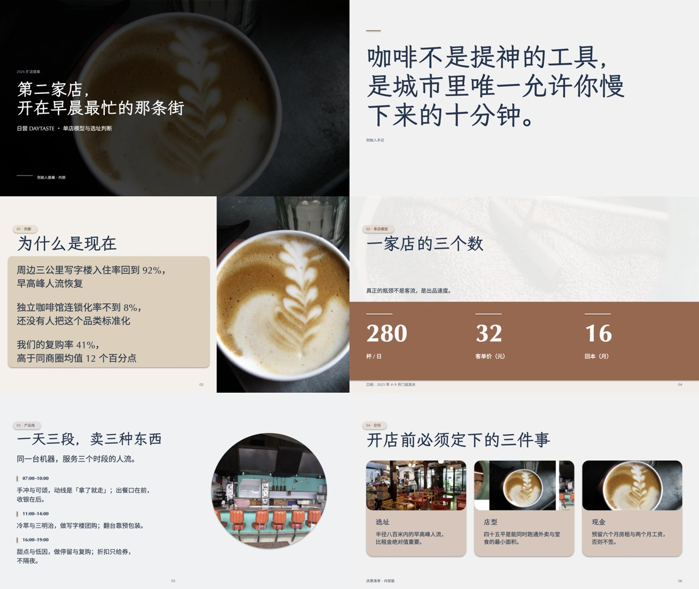

# 格律 Metre

**GitHub:** [Leica-Shen/deepseek-harness-metre](https://github.com/Leica-Shen/deepseek-harness-metre)

**A measurement-driven slide engine for [DeepSeek Harness](https://github.com/deepseek-ai).**
Write what each page should say; Metre measures the text, breaks the lines, places the blocks,
sources the images and audits the result. Five design languages, no template copying.

> 中文名「格律」：格是网格，律是节奏。先量字，再排版。



## Why another PPT generator

Most generators are template engines: a fixed coordinate grid plus an autofit box that lets
PowerPoint guess. The result is either overflow or a half-empty page, and it cannot be audited.

Metre inverts the order:

| | template engines | Metre |
| --- | --- | --- |
| text height | estimated from character count | measured with real font metrics |
| line breaks | left to the renderer | solved with DP, written as `a:br` |
| layout | hard-coded coordinates | composition + vertical distribution law |
| whitespace | whatever is left | an audited quantity (largest empty rectangle) |
| colour | one theme colour | paper / panel / accent follow the image palette |
| quality | eyeballed | 10 geometric checks, reproducible before render |

## Features

- **Real typography** — font metrics via Pillow, optimal (DP) line breaking with CJK
  kinsoku rules, exact line spacing (`spcPts`), manual breaks so PowerPoint / WPS / Keynote agree.
- **Vertical distribution law** — leftover space has exactly three destinations: grow the gaps
  (with a cap), optically centre the group, or hand it to a fill device. Never scale elements up.
- **Five design languages** — paper, ink, type scale, margins, media treatment, ornament
  vocabulary, transparency, whitespace register. Each pairs a Latin and a Chinese family
  (霞鹜文楷 / 得意黑 / 思源宋体 / 阿里巴巴普惠体 …), not a single system font.
- **Images from the web** — `metre fetch` searches Wikimedia Commons, filters by licence
  (CC0 / CC BY / CC BY-SA / PD), downloads and records provenance. Images can be used as
  full-bleed background, **shape fill** (`blipFill` on an autoshape) or **text fill**
  (`blipFill` inside `a:rPr`).
- **Deck-wide palette** — the cover image sets the colour temperature; each page can still be
  re-tinted by its own image.
- **Audit before render** — overlap, out-of-bounds, contrast (real background per text run),
  type scale, alignment axes, spacing, whitespace register, image coverage, rhythm, fingerprints.
- **Self-test** — `metre selftest` asserts layout, determinism, information integrity,
  absence of leaked paths, size limits and prompt-injection safety of `SKILL.md`.

## Install

```bash
git clone git@github.com:<you>/metre.git
cd metre
python3 -m pip install -r requirements.txt
```

Requires Python 3.10+, `python-pptx`, `Pillow`, `lxml`, `numpy`.

**Platform**: the metrics layer reads real font files. The default language set assumes macOS
fonts (Optima, Futura, Bangla MN, Big Caslon) plus Chinese families
(霞鹜文楷 LXGW WenKai, 得意黑 Smiley Sans, 思源黑体/宋体, 阿里巴巴普惠体).
`python3 -m studio.cli selftest` prints a readable error listing any missing file.

```bash
python3 -m studio.cli spec                              # list the five languages
python3 -m studio.cli build examples/coffee/deck.json out.pptx
python3 -m studio.cli build examples/coffee/deck.json out.pptx --png preview/
python3 -m studio.cli fetch assets/coffee "coffee roasting|latte art" --n 6
python3 -m studio.cli selftest
```

`--png` uses Keynote on macOS; any `pptx → png` exporter works.

## Four knobs, none required

| knob | values | default |
| --- | --- | --- |
| `language` | `sweet` `iron` `paper` `grid` `manifesto` | `grid` |
| `variation` | int / string / `auto` | seeded from the content itself — same deck reproduces, different decks get different faces |
| `fonts` | `auto` or `{ea_display, ea_body, ea_micro}` | picked from a tone-matched pool (LXGW WenKai / Source Han Serif / Sans / Alibaba PuHuiTi / Smiley Sans) |
| `color_mode` | `language` / `image` (+ `accent_from_image`) | paper from the language; each page is still tinted by its own image |

Colours are no longer locked: `color_mode: "image"` derives paper tint, panel and accent from the
cover photograph, and any page can override with `accent` / `panel`.

Layouts rotate per deck from the language's pool (`side-r`, `side-l`, `stack`, `full`, `inset`) —
the planner never uses the same media placement twice in a row.

## Machine-readable contract

```bash
python3 -m studio.cli spec --json      # languages, page kinds, required keys, style fields
```

`schema/deck.schema.json` validates a deck before you build it.

## Content model

```json
{
  "language": "sweet",
  "assets": "assets/",
  "pages": [
    {"kind": "cover", "kicker": "2026", "title": "第二家店，开在早晨最忙的那条街",
     "sub": "单店模型与选址判断", "image": "assets/cover.jpg"},
    {"kind": "points", "title": "为什么是现在",
     "items": ["周边写字楼入住率回到 92%", "独立咖啡馆连锁化率不到 8%", "复购率 41%"]},
    {"kind": "band", "title": "一家店的三个数",
     "metrics": [{"v": "280", "l": "杯 / 日"}, {"v": "32", "l": "客单价"}, {"v": "16", "l": "回本（月）"}]},
    {"kind": "table", "title": "三种店型，三本账",
     "columns": ["店型", "面积", "投入"], "rows": [["街角店", "45 m²", "180 万"]]}
  ]
}
```

Page kinds: `cover` `section` `statement` `points` `metrics` `band` `cards` `split`
`imagepanel` `compare` `table` `chart` `gallery` `quote` `closing`.

## Design languages

| id | name | Latin + Chinese | character |
| --- | --- | --- | --- |
| `sweet` | 甜本 | Optima + 霞鹜文楷 | pale paper, rounded cards, gold numerals |
| `iron` | 铁报 | Bangla MN + 得意黑 | black / white / red, full-bleed, type as image |
| `paper` | 纸案 | Optima + 思源宋体 / 霞鹜文楷 | wide margins, sticky notes, hairlines |
| `grid` | 格物 | Futura + 阿里巴巴普惠体 | white paper, rules, multi-column report |
| `manifesto` | 宣言 | Big Caslon + 思源宋体 | large serif, striped paper, bleeding photos |

Pick by density and temperament, not by brand. One language per deck.

## Repository layout

```
studio/textmetrics.py   metrics, DP line breaking, CJK kinsoku
studio/languages.py     the five languages (the only place with numbers)
studio/palette.py       image → paper / panel / accent
studio/compose.py       page → composition → ops
studio/audit.py         ten geometric checks + whitespace + coverage
studio/render.py        ops → pptx (all autofit disabled)
studio/images.py        Wikimedia Commons search / download / provenance
studio/selftest.py      six-class self test
design/                 the rules behind every number
examples/coffee/        a complete deck (content + images + preview)
```

## Credits

Example photographs come from Wikimedia Commons (CC BY / CC BY-SA); see
`examples/coffee/assets` provenance and the footer of the example deck.
Fonts are referenced by family name and are **not** bundled.

## License

MIT — see [LICENSE](LICENSE).
